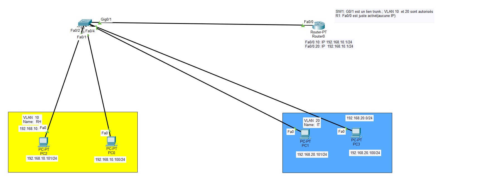

# 🔀 Inter-VLAN Routing (Router-on-a-Stick)


## 📖 Description

Ce lab met en place un réseau local segmenté en **deux VLAN**. Un switch Cisco 2960 (SW1) relie quatre PC et un routeur (Router0). Le routeur assure le routage entre les VLAN avec la méthode **router-on-a-stick** : un seul lien physique trunk et des sous-interfaces dot1Q.

## 🗺️ Topologie



| Équipement | Interface | Rôle |
|---|---|---|
| SW1 (2960) | Gig0/1 | Trunk vers Router0 (VLAN 10 et 20 autorisés) |
| SW1 (2960) | Fa0/1, Fa0/2 | Ports d'accès VLAN 10 |
| SW1 (2960) | Fa0/3, Fa0/4 | Ports d'accès VLAN 20 |
| Router0 | Fa0/0 | Interface physique activée, sans adresse IP |
| Router0 | Fa0/0.10 et Fa0/0.20 | Sous-interfaces dot1Q (une par VLAN) |

## 🧾 Plan d'adressage

| VLAN | Nom | Réseau | Passerelle | Machines |
|---|---|---|---|---|
| 10 | RH | 192.168.10.0/24 | 192.168.10.1 | PC0 : 192.168.10.100 <br> PC2 : 192.168.10.101 |
| 20 | IT | 192.168.20.0/24 | 192.168.20.1 | PC3 : 192.168.20.100 <br> PC1 : 192.168.20.101 |

## 🎯 Objectifs

- Segmenter un réseau en VLAN (RH et IT) pour isoler le trafic.
- Configurer un lien trunk 802.1Q entre le switch et le routeur.
- Permettre la communication entre VLAN avec un seul lien physique.
- Valider la configuration avec des tests de connectivité.

## ⚙️ Configuration

### SW1

```text
vlan 10
 name RH
vlan 20
 name IT
!
interface range fa0/1 - 2
 switchport mode access
 switchport access vlan 10
!
interface range fa0/3 - 4
 switchport mode access
 switchport access vlan 20
!
interface g0/1
 switchport mode trunk
 switchport trunk allowed vlan 10,20
```

### Router0

```text
interface fa0/0
 no shutdown
!
interface fa0/0.10
 encapsulation dot1Q 10
 ip address 192.168.10.1 255.255.255.0
!
interface fa0/0.20
 encapsulation dot1Q 20
 ip address 192.168.20.1 255.255.255.0
```

### Configuration des PC

| PC | Adresse IP | Masque | Passerelle |
|---|---|---|---|
| PC0 | 192.168.10.100 | 255.255.255.0 | 192.168.10.1 |
| PC2 | 192.168.10.101 | 255.255.255.0 | 192.168.10.1 |
| PC3 | 192.168.20.100 | 255.255.255.0 | 192.168.20.1 |
| PC1 | 192.168.20.101 | 255.255.255.0 | 192.168.20.1 |

## ✅ Vérification

| Test | Commande | Résultat attendu |
|---|---|---|
| VLAN et ports | `show vlan brief` (SW1) | Fa0/1-2 en VLAN 10, Fa0/3-4 en VLAN 20 |
| Trunk | `show interfaces trunk` (SW1) | Gig0/1 en trunk, VLAN 10 et 20 autorisés |
| Sous-interfaces | `show ip interface brief` (Router0) | Fa0/0.10 et Fa0/0.20 en up/up |
| Routage | `show ip route` (Router0) | Deux réseaux connectés (C) |
| Même VLAN | `ping 192.168.10.101` depuis PC0 | Réussi |
| Inter-VLAN | `ping 192.168.20.100` depuis PC0 | Réussi |

## 🧠 Compétences acquises

- Créer et nommer des VLAN, puis affecter les ports en mode access.
- Configurer un port trunk et restreindre les VLAN autorisés.
- Comprendre l'encapsulation 802.1Q et le rôle des tags VLAN.
- Créer des sous-interfaces sur le routeur, chacune servant de passerelle à son VLAN.
- Planifier l'adressage IP et configurer les passerelles par défaut.
- Tester et dépanner avec `ping` et les commandes `show`.
- Comprendre que deux VLAN ne communiquent pas sans routage de couche 3.

## 🛠️ Dépannage courant

- **Ping inter-VLAN en échec** : vérifie la passerelle configurée sur les PC.
- **Sous-interface down** : vérifie que `no shutdown` est appliqué sur Fa0/0.
- **Pas de trafic via le trunk** : vérifie `switchport trunk allowed vlan` et le mode trunk.
- **Mauvais VLAN** : contrôle l'affectation des ports avec `show vlan brief`.

## 🧰 Outils

- Cisco Packet Tracer
- Switch Catalyst 2960, routeur Router-PT

## 👤 Auteur

Jacob Diakité, étudiant
